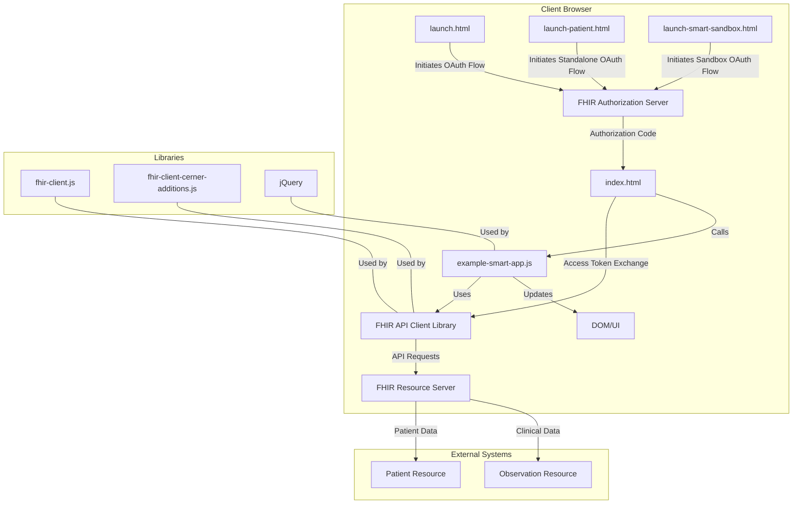

# Architecture Analysis Report

## Summary
The codebase represents a SMART on FHIR tutorial application that demonstrates how to build healthcare applications that integrate with Electronic Health Record (EHR) systems. The architecture follows a client-side single-page application pattern where JavaScript code interacts directly with FHIR resources through standardized APIs. The application uses OAuth 2.0 for authentication and authorization, following the SMART App Launch Framework protocol. The architecture exemplifies a microservice-oriented approach where the app acts as a consumer of FHIR services exposed by healthcare systems.

## Entry Points
- `/source/example-smart-app/launch.html` → OAuth 2.0 authorization entry point for EHR-launched applications
- `/source/example-smart-app/launch-patient.html` → OAuth 2.0 authorization entry point for patient standalone applications
- `/source/example-smart-app/launch-smart-sandbox.html` → OAuth 2.0 authorization entry point for SMART Health IT Sandbox
- `/source/example-smart-app/index.html` → Main application entry point (redirect target after authorization)

## UI/Backend Violations
- `source/example-smart-app/index.html:196-208`: Inline JavaScript directly calls `extractData()` and handles the promise resolution in the HTML file rather than in a separate JavaScript module
  ```javascript
  <script>
    extractData().then(
      //Display Patient Demographics and Observations if extractData was success
      function(p) {
        drawVisualization(p);
      },

      //Display 'Failed to call FHIR Service' if extractData failed
      function() {
        $('#errors').html('<p> Failed to call FHIR Service </p>');
      }
    );
  </script>
  ```

## Architectural Style
- **Microservice Consumer Architecture**: The application is designed to consume FHIR services exposed by healthcare systems, following a microservice-oriented approach where the app interacts with standardized APIs.
- **Single-Page Application (SPA)**: The application is a client-side JavaScript application that loads a single HTML page and dynamically updates as the user interacts with it.
- **OAuth 2.0 Authorization Code Flow**: For authentication and authorization, the app implements the OAuth 2.0 authorization code flow as specified by the SMART App Launch Framework.
- **RESTful API Consumption**: The app consumes RESTful FHIR APIs to retrieve patient and observation data.

## Architecture Diagram


## Details

### Authentication & Authorization Flow
The application implements the SMART App Launch Framework, which is based on OAuth 2.0. There are three launch scenarios:

1. **EHR Launch** (`launch.html`):
   - Initiated from within an EHR system
   - Receives `iss` and `launch` parameters
   - Uses `FHIR.oauth2.authorize()` to redirect to the authorization server

2. **Patient Standalone Launch** (`launch-patient.html`):
   - Initiated directly by a patient
   - Uses `launch/patient` scope to request patient context
   - Requires `iss` parameter to identify the FHIR server

3. **SMART Health IT Sandbox Launch** (`launch-smart-sandbox.html`):
   - Specific configuration for testing with SMART Health IT Sandbox
   - Similar flow to EHR launch but with different client ID

Code example from `launch.html`:
```javascript
FHIR.oauth2.authorize({
  'client_id': '<enter your client id here>',
  'scope':  'patient/Patient.read patient/Observation.read launch online_access openid profile'
});
```

### Data Access Layer
The application uses the FHIR Client JavaScript library to interact with FHIR resources. The main data access functions are in `example-smart-app.js`:

1. **Authentication Handling**:
   ```javascript
   FHIR.oauth2.ready(onReady, onError);
   ```

2. **Resource Retrieval**:
   ```javascript
   var patient = smart.patient;
   var pt = patient.read();
   var obv = smart.patient.api.fetchAll({
     type: 'Observation',
     query: {
       code: {
         $or: ['http://loinc.org|8302-2', 'http://loinc.org|8462-4',
               'http://loinc.org|8480-6', 'http://loinc.org|2085-9',
               'http://loinc.org|2089-1', 'http://loinc.org|55284-4']
       }
     }
   });
   ```

3. **Data Processing**:
   ```javascript
   var byCodes = smart.byCodes(obv, 'code');
   var height = byCodes('8302-2');
   var systolicbp = getBloodPressureValue(byCodes('55284-4'),'8480-6');
   ```

### Presentation Layer
The application uses a simple HTML structure with jQuery for DOM manipulation:

1. **HTML Structure** (`index.html`):
   - Contains tables for patient demographics and observations
   - Uses ID placeholders for dynamic content

2. **UI Update** (`example-smart-app.js`):
   ```javascript
   window.drawVisualization = function(p) {
     $('#holder').show();
     $('#loading').hide();
     $('#fname').html(p.fname);
     $('#lname').html(p.lname);
     // ...additional fields
   };
   ```

### Security Considerations
The application includes specific security measures for different deployment scenarios:

1. **MPages Integration Security**:
   - Uses Cross-Frame-Container (XFC) library to prevent clickjacking attacks
   - Requires specific CSS and JS files: `cerner-smart-embeddable-lib-[version].min.css/js`
   - Uses `hidden` attribute on HTML tag for secure rendering

2. **Session Security**:
   - Uses `fhir-client-cerner-additions` to prevent session bleed in embedded browsers

### Library Dependencies
1. **Core Libraries**:
   - `fhir-client-v0.1.12.js`: Main FHIR client library for API interactions
   - `fhir-client-cerner-additions-1.0.0.js`: Cerner-specific extensions
   - jQuery: Used for DOM manipulation and AJAX promises

2. **Optional Libraries** (for MPages integration):
   - `babel-polyfill`: For ES2015+ compatibility
   - `cerner-smart-embeddable-lib`: For secure embedding in MPages

### Microservice Integration Pattern
The application demonstrates a consumer-side integration with healthcare microservices:

1. **Service Discovery**:
   - Uses the `iss` parameter to identify the FHIR server endpoint
   - Queries the metadata endpoint to discover authorization endpoints

2. **Standardized API Consumption**:
   - Uses standardized FHIR resource paths and query parameters
   - Handles authentication tokens transparently through the FHIR client library

3. **Loose Coupling**:
   - Designed to work with any FHIR-compliant server (Cerner, SMART Health IT, etc.)
   - Uses standard scopes and authorization flows

This architecture exemplifies how client applications can integrate with healthcare microservices using standardized protocols and APIs, enabling interoperability across different EHR systems.